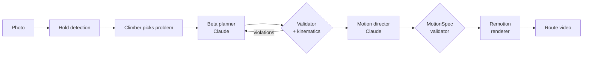

# Beta

**Photograph a boulder. Get the beta — and watch it climbed.**

Beta is an AI climbing coach. Snap a photo of a problem you can't solve; Beta finds the holds, you
confirm which ones belong to the problem, and it returns:

- a **move-by-move beta** tailored to your height, ape index and style — which limb goes where,
  with what technique, and where the crux is;
- a **route video**: a climber figure performs that beta over your photo, with camera moves,
  highlighted holds and slow motion on the crux. Each move is a chapter you can scrub to.

Claude does the reasoning (planning the beta, directing the video). Deterministic code does the
geometry: hold detection, a beta validator, 2D kinematics that check every move is reachable, and a
Remotion renderer that turns Claude's motion timeline into an MP4.



## Quick start

```bash
make bootstrap          # uv + npm deps, git hooks
make test               # all test suites
make seed data          # synthetic walls through bronze -> silver -> gold
make dev                # API on :8000, renderer on :8787
```

Works fully offline: without `ANTHROPIC_API_KEY` the API uses a heuristic planner and director.
The iOS app lives in `apps/ios` (needs Xcode; see [dev setup](docs/guides/dev-setup.md)).

## Repository layout

| | |
|---|---|
| `apps/api` | FastAPI service (composition root) |
| `apps/renderer` | Remotion route-video renderer |
| `apps/ios` | SwiftUI app + `BetaKit` package |
| `packages/core` | Domain, ports, use cases, validators, kinematics |
| `packages/vision` | Preprocessing, hold detection, overlays, synthetic walls |
| `packages/llm` | Claude adapters + offline heuristics, prompt registry |
| `packages/data` | Medallion lakehouse (bronze/silver/gold) |
| `evals` | Golden-set evaluation harness |
| `prompts` | Versioned prompts |
| `contracts` | Generated JSON Schema / OpenAPI / cross-language fixtures |
| `docs` | Product, architecture, ADRs, data, agent docs, guides |

Start with [AGENTS.md](AGENTS.md) (how to work here) and [docs/index.md](docs/index.md).

## Safety

Beta suggests movement; it cannot see everything a climber on the wall can. Climb within your
ability, check landings and pads, and treat every beta as a hypothesis.

## License

MIT — see [LICENSE](LICENSE).
