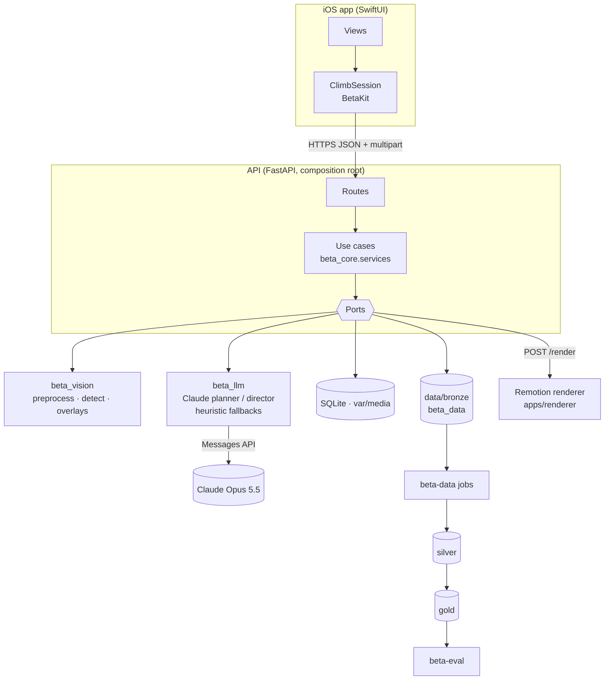

# Architecture overview

## Containers

| Container | Tech | Responsibility |
|---|---|---|
| iOS app | SwiftUI, BetaKit | Capture, hold review, beta + video playback, feedback, logbook |
| API | FastAPI, uvicorn | HTTP surface, background jobs, adapter wiring |
| Renderer | Node, Remotion | MotionSpec → MP4 + poster |
| Lakehouse | Parquet, DuckDB, DVC | Bronze/silver/gold data, lineage |
| Claude | Messages API | Beta planning, motion direction, hold classification |

## Request lifecycle

1. `POST /v1/analyses` — sanitise (strip GPS) → bronze; normalise; detect holds; estimate scale.
2. `PUT /v1/analyses/{id}/problem` — the climber's selection becomes a `Problem`.
3. `POST /v1/analyses/{id}/betas` → 202 — background: set-of-marks image → planner → validator
   (repair ≤2) → `beta.generated`.
4. `POST /v1/betas/{id}/videos` → 202 — background: director → MotionSpec validator (repair ≤1) →
   renderer → `video.rendered`.
5. `POST /v1/betas/{id}/feedback` — sent / useful / move looks wrong / rewatch.

Every step emits a domain event into bronze; the operational store (SQLite) only serves the app.

## Where to go next

- [Hexagonal core](hexagonal.md) — ports, adapters, the dependency rule.
- [Generation pipeline](pipeline.md) — planner, validator, director, renderer in detail.
- [MotionSpec](motion-spec.md) and [Kinematics](kinematics.md) — how the video is defined.
