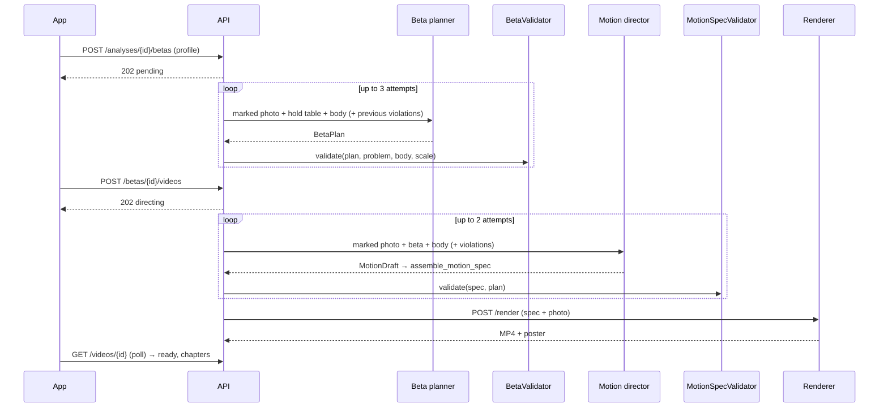

# Generation pipeline

## Grounding

The model never sees a bare photo. It gets the photo with a numbered ring on every problem hold
(set-of-marks), a JSON table of those holds in image pixels, the climber's reach in pixels, and a
schema it must answer in (structured outputs). Moves refer to hold IDs, so a hallucinated hold is a
validation error, not something the climber sees (ADR-0005).

## Validators

`BetaValidator` (beta_core/validation.py):

| Code | Rule |
|---|---|
| `empty_beta`, `move_index_sequence` | at least one move, indices 0..n-1 |
| `unknown_hold` | every hold ID belongs to the problem |
| `start_hands_missing`, `start_not_on_start_holds` | both hands start on start holds |
| `no_op_move` | a limb never "moves" to the hold it is on |
| `not_finished` | both hands end matched on the top |
| `crux_index_out_of_range` | crux points at a real move |
| `unreachable` | some hip position reaches every contact (≤ 108% of limb length) |

`MotionSpecValidator`: keyframe sequence and timing, contacts identical to the beta, camera inside
the photo, annotations reference real holds, hip within reach (≤ 112%), one chapter per move.

Violations go back to the model verbatim as repair instructions.

## Offline mode

Without `ANTHROPIC_API_KEY`, `HeuristicBetaPlanner` (greedy, kinematics-checked) and
`ChoreographyDirector` (rule-based pacing) take over. They are the baseline Claude must beat in
evals and keep development, CI and the iOS app usable offline.
