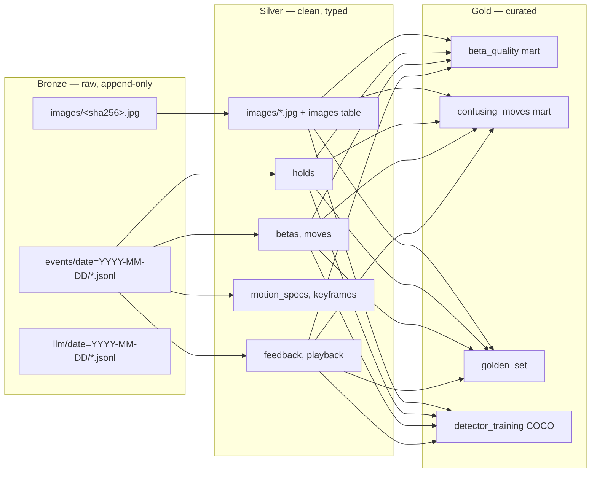

# Medallion architecture



## Layers

| Layer | Written by | Format | Mutability |
|---|---|---|---|
| Bronze | API (via `BronzeWriter`), `beta-data seed/ingest` | original image bytes (GPS stripped), JSONL | append-only, never edited |
| Silver | `beta-data run bronze-to-silver` | JPEG (no EXIF) + Parquet | rebuilt idempotently from bronze |
| Gold | `beta-data run silver-to-gold` | Parquet, COCO JSON, JSONL | rebuilt from silver; released as DVC snapshots |

## Bronze event envelope

Every line in `bronze/events/date=YYYY-MM-DD/*.jsonl`:

```json
{
  "event_id": "evt_01J…",
  "name": "beta.generated",
  "occurred_at": "2026-10-30T12:00:00Z",
  "entity_id": "bet_…",
  "schema_version": 1,
  "payload": { "…": "event-specific" }
}
```

Event names: `image.ingested`, `holds.detected`, `problem.selected`, `beta.generated`,
`beta.failed`, `video.directed`, `video.rendered`, `video.failed`, `feedback.recorded`,
`playback.recorded`. Payloads are the serialised domain objects, so silver can be rebuilt without
the operational database.

## Silver and gold tables

Exact columns and versions live in `beta_data.contracts` and are documented in
[contracts](contracts.md).

## Lineage

Every job run writes `data/_manifests/<job>/<run_id>.json` with inputs (path + sha256), outputs,
row counts, contract versions and the git commit. A table can always be traced back to the bronze
files that produced it.

## Versioning with DVC

`dvc.yaml` declares `seed → bronze_to_silver → silver_to_gold`. `make dvc-repro` re-runs stale stages;
`dvc push` uploads to the remote. Tag releases of gold (`gold-v0.1.0`) in git so a dataset version is
a commit.
